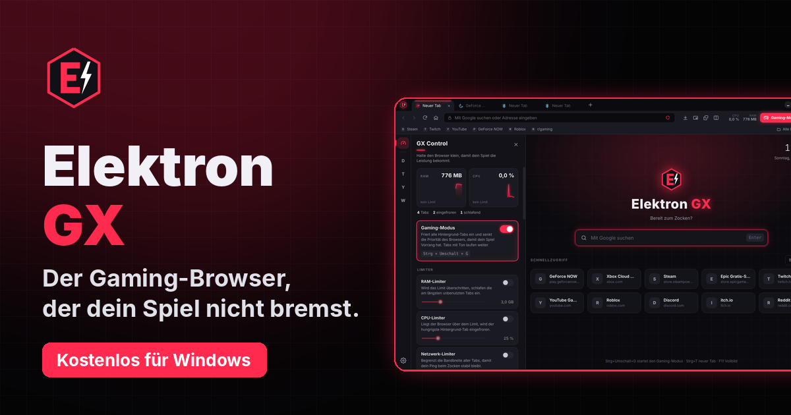
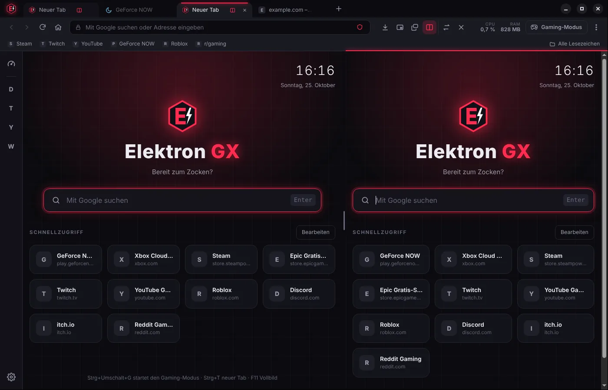
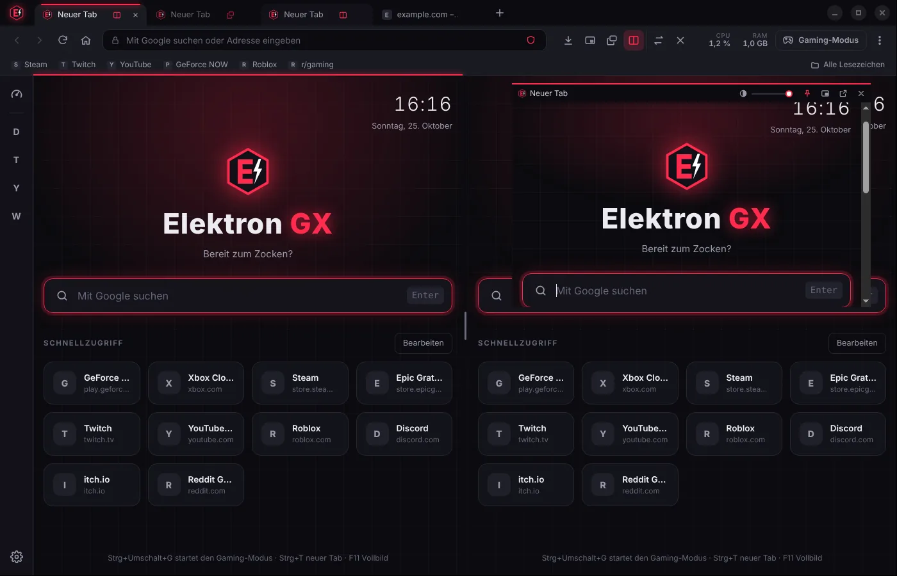

# Elektron GX – der Gaming-Browser



**Kostenloser Browser für PC-Gamer auf Chromium-Basis.** Gaming-Modus, RAM-/CPU-/Netzwerk-Limiter, Split-Screen, schwebende Fenster, Werbeblocker inkl. YouTube, Chrome-Erweiterungen, Claude & ChatGPT in der Seitenleiste.

**[⬇ Download für Windows](https://obimokenobix.github.io/elektron-gx/)** · [Alle Versionen](https://github.com/obimokenobix/elektron-gx/releases)

| Split-Screen | Schwebendes Fenster |
| --- | --- |
|  |  |

## Funktionen

- **GX Control** (Tacho-Symbol links): Live-Anzeige von RAM und CPU des Browsers
- **RAM-Limiter**: legt die am längsten unbenutzten Tabs schlafen, wenn das Limit überschritten wird
- **CPU-Limiter**: friert den hungrigsten Hintergrund-Tab ein, wenn der Browser zu viel CPU braucht
- **Netzwerk-Limiter**: begrenzt die Bandbreite aller Tabs
- **Gaming-Modus** (Strg+Umschalt+G): friert alle Hintergrund-Tabs ein und senkt die Prozess-Priorität des Browsers
- **Beim Minimieren einfrieren**: Tabs ohne Ton ruhen, solange der Browser minimiert ist
- **Werbeblocker** (Ghostery-Engine, volle Listen inkl. Cookie-Banner) mit Zähler, blockiert Werbe-Popups
- **YouTube-Werbung überspringen**: Videowerbung wird stummgeschaltet und sofort übersprungen
- **Split-Screen** (Strg+Umschalt+S): zwei Tabs nebeneinander, Trennlinie ziehbar
- **Schwebende Fenster** (Strg+Umschalt+F): Tab als kleines Fenster immer im Vordergrund, mit Transparenz-Regler
- **Video ausklappen** (Strg+Umschalt+P): Bild-in-Bild, auch automatisch beim Tab-Wechsel oder Minimieren
- **Webcam/Mikrofon-Regeln**: Kamera standardmäßig ohne Nachfrage blockiert
- **Seitenleiste** mit Discord, Twitch, YouTube und WhatsApp – läuft im Hintergrund weiter (z. B. Discord-Sprachkanal)
- **Gaming-Startseite** mit Google-Suche und bearbeitbarem Schnellzugriff
- Dedizierte Grafikkarte erzwingen, FPS-Limit für Browser-Spiele aufheben
- Tabs wiederherstellen (laden erst beim Anklicken), Akzentfarben, Downloads, Berechtigungs-Abfragen

- **Lesezeichen** mit Stern in der Adressleiste, Lesezeichenleiste und Verwaltung; Import aus Edge, Chrome und Opera GX
- **Verlauf** mit Suche und Löschen (letzte Stunde, 24 Stunden, alles)
- **Vorschläge in der Adressleiste** aus Lesezeichen, Verlauf und Google
- **Suchen auf der Seite** (Strg+F), **Downloads-Übersicht** mit Fortschritt, **private Tabs**
- **PDF-Anzeige** und **Rechtschreibprüfung** (Deutsch/Englisch)
- **Chrome-Erweiterungen** aus dem Chrome Web Store (Symbole in der Leiste, Popups, Rechtsklick-Einträge, automatische Updates), Verwaltung unter `elektron://start/extensions.html`
- **Claude und ChatGPT** in der Seitenleiste
- **Phishing- und Malware-Schutz** mit öffentlichen Sperrlisten (Phishing.Database, URLhaus), Warnseite, auch für Downloads
- **Nur-HTTPS-Modus** mit Warnseite für unverschlüsselte Seiten
- **Virenscan für Downloads** mit dem eingebauten Microsoft Defender
- **Automatische Chromium-Sicherheitsupdates** (`.github/workflows/chromium-update.yml`, täglich)
- **Willkommensseite beim ersten Start** mit empfohlenen Erweiterungen (Malwarebytes Browser Guard, Bitwarden, optional Avast) zum Ankreuzen
- **Automatische Updates** über GitHub Releases; als Standardbrowser auswählbar

**Neu in 2.6 – Datenschutz**

- **Schild in der Adressleiste**: zeigt pro Seite, was blockiert wurde; Werbeblocker, Fremd-Cookies und Fingerprint-Schutz pro Seite abschaltbar; **JavaScript pro Seite blockieren**; **Seite beim Schließen vergessen** (Cookies und Website-Daten löschen)
- **Links säubern**: entfernt utm_, fbclid, gclid & Co., überspringt Umleitungs-Tracker (Google, Facebook, Instagram, YouTube, Reddit …), öffnet AMP-Seiten im Original (`privacy.js`)
- **WebRTC-IP-Schutz**: Webseiten sehen deine lokale IP-Adresse nicht (auch hinter VPN)
- **Global Privacy Control** (`Sec-GPC: 1` und `navigator.globalPrivacyControl`)
- **Stärkerer Fingerprint-Schutz**: zusätzlich Audio, und jetzt auch in eingebetteten Frames (iframes)
- **Website-Symbole ohne Google** (`favicons.js`): direkt von der Seite, mit Zwischenspeicher
- **Suchmaschine wählbar**: Google, DuckDuckGo, Brave Search, Startpage; Suchvorschläge abschaltbar
- **Links vorladen abschaltbar** (in privaten Tabs immer aus)
- **Oberfläche über eigenes Protokoll** (`elektron-ui://`) – Datei-Sonderrechte (Fuse) wieder aus

**Neu in 2.5 – Sicherheit**

- **Sicherheits-Check** in GX Control: zeigt auf einen Blick, welche Schutzfunktionen aktiv sind
- **Fremd-Cookies blockieren** (Tracking-Schutz) mit Ausnahmen für Anmelden, Captchas, Bezahlen und Seiten derselben Firma (`privacy.js`)
- **Schutz vor Fingerprinting**: Canvas-Rauschen pro Seite und Browser-Start, allgemeiner WebGL-Grafikkarten-Name, einheitliche CPU-/RAM-Werte (`preload-internal.js`)
- **Sicheres DNS** (DNS über HTTPS mit Quad9, sperrt zusätzlich Schadsoftware-Domains)
- **Gehärtetes Programm** (Electron-Fuses): kein `ELECTRON_RUN_AS_NODE`, kein `NODE_OPTIONS`, kein `--inspect`, verschlüsselte Cookies, App-Code nur aus geprüftem `app.asar` (ASAR-Integrität)
- **Starttest vor jeder Veröffentlichung**: Die gebaute Windows-Version wird im CI gestartet – nur wenn sie läuft, wird sie veröffentlicht

**Neu in 2.4**

- **Browser-Stil umschaltbar**: Gaming (alle Extras) oder Normal (ruhig, blau, ohne Gaming-Anzeigen) – Menü oder GX Control → Design
- **8 Hintergründe** für die Startseite (Neon, Schlicht, Nebel, Galaxie, Retro, Polarlicht, Wellen, eigenes Bild)
- **Deine Steam-Spiele** auf der Startseite, Start mit einem Klick
- **Grafikkarten-Anzeige** in GX Control (Auslastung, Temperatur, VRAM, Watt) über `nvidia-smi` bei NVIDIA-Karten
- **Screenshots** (Strg+Umschalt+X, auch ganze Seite) – gespeichert unter Bilder\Elektron GX und in die Zwischenablage kopiert
- **Lesemodus** (F9 oder Buch-Symbol): nur Text, ohne Werbung und Menüs
- **KI per Rechtsklick**: Seite zusammenfassen, Markiertes erklären (Claude oder ChatGPT)
- **Übersetzen** von Seiten und markiertem Text (Google Übersetzer)
- **Sichern & Wiederherstellen** von Lesezeichen, Schnellzugriff und Einstellungen als Datei
- **Schnelleres Laden**: Verbindung wird schon beim Zeigen auf einen Link aufgebaut, Erweiterungen laden parallel zum Fenster

## Tastenkürzel

| Kürzel | Aktion |
|---|---|
| Strg+T / Strg+W | Neuer Tab / Tab schließen |
| Strg+Umschalt+T | Geschlossenen Tab wiederherstellen |
| Strg+Tab, Strg+1…9 | Tabs wechseln |
| Strg+L | Adressleiste |
| F5 / Strg+F5 | Neu laden / ohne Cache |
| Alt+← / Alt+→ | Zurück / Vor |
| F11 | Vollbild |
| Strg+Umschalt+G | Gaming-Modus |
| Strg+Umschalt+S | Split-Screen |
| Strg+Umschalt+F | Tab als schwebendes Fenster |
| Strg+Umschalt+P | Video ausklappen (Bild-in-Bild) |
| Strg+Umschalt+X | Screenshot |
| F9 | Lesemodus |
| Strg+Umschalt+N | Privater Tab |
| Strg+D / Strg+Umschalt+B / Strg+Umschalt+O | Lesezeichen setzen / Leiste ein-aus / verwalten |
| Strg+H / Strg+J | Verlauf / Downloads |
| Strg+F, F3 | Auf der Seite suchen, nächster Treffer |
| Strg+P | Drucken |
| Strg+Plus / Minus / 0 | Zoom |
| F12 | Entwicklertools |

## Selbst bauen (Windows)

Voraussetzung: [Node.js](https://nodejs.org) (LTS).

```
npm install
npm start            # Browser starten
npm run dist:win     # Windows-Installer in dist\ erzeugen
```

## Updates veröffentlichen

1. In `package.json` die Versionsnummer erhöhen (z. B. 2.0.0 → 2.0.1), committen und hochladen.
2. GitHub baut den Installer automatisch auf Windows (`.github/workflows/release.yml`) und veröffentlicht ihn als Release.
3. Fertig – installierte Browser finden das Update innerhalb von 4 Stunden (oder sofort über „Nach Updates suchen“).

Die Update-Adresse (`releases/latest/download/`) steht in `update.json` und lässt sich in GX Control → Updates ändern.
Die Webseite liegt im Ordner `docs/` und wird über GitHub Pages veröffentlicht: https://obimokenobix.github.io/elektron-gx/
Neue Chromium-Sicherheitsupdates kommen durch eine neuere Electron-Version: `npm install electron@latest`, Version erhöhen, neu bauen, hochladen.

## Grenzen

- Netflix, Disney+ und andere DRM-Dienste funktionieren nicht (kein Widevine in Electron).
- Sehr umfangreiche Chrome-Erweiterungen (z. B. mit eigener Seitenleiste) laufen evtl. nur teilweise.
- Die App ist nicht signiert – Windows SmartScreen fragt bei der Installation nach.
- Kein Passwort-Manager und keine Synchronisierung zwischen Geräten.

## Projektstruktur

- `main.js` – Hauptprozess: Fenster, Tabs, Limiter, Gaming-Modus, Werbeblocker, Updates
- `store.js` – Lesezeichen, Verlauf, Downloads (JSON im Benutzerordner)
- `extensions.js` – Chrome-Erweiterungen und Chrome Web Store
- `installer.nsh` – Registrierung als Browser bei Windows
- `preload-ui.js` – sichere Brücke zwischen Oberfläche und Hauptprozess
- `preload-float.js`, `ui/float.*` – Leiste der schwebenden Fenster
- `ui/` – Browser-Oberfläche (Tabs, Adressleiste, Seitenleiste, GX Control)
- `start/` – Startseite und Fehlerseite (`elektron://start/`)
- `assets/` – Logo und Icons

## Microsoft Store

1. Kostenloses Entwicklerkonto unter https://storedeveloper.microsoft.com anlegen und den Namen „Elektron GX“ reservieren.
2. Im Partner Center unter *Produktidentität* die Werte *Package/Identity/Name*, *Package/Identity/Publisher* und *PublisherDisplayName* in `package.json` → `build.appx` eintragen (`identityName`, `publisher`, `publisherDisplayName`).
3. Auf GitHub unter *Actions → Microsoft Store → Run workflow* das Paket bauen und die `.appx` aus den Artefakten im Partner Center hochladen.
4. Datenschutz-Adresse für den Store: https://obimokenobix.github.io/elektron-gx/datenschutz.html
